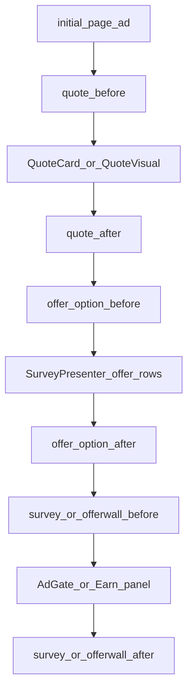

# Google AdSense Placement Plan

**Status:** PLAN-ONLY (ready for later implementation)  
**Product:** Proceeds with Positivity  
**Scope:** Display AdSense units around quotes, surveys, and offerwalls — not rewarded earn integration.

---

## 1. Objective and non-goals

### Objective

Satisfy the client request for Google AdSense placements:

- After an **initial** AdSense unit on the page
- **Before and after every quote**
- **Before and after every survey** and **every offerwall**
- **Before and after every survey / offerwall option** that appears after a quote

Publisher display revenue only.

### Non-goals

- AdSense as a survey/offerwall / points provider
- Crediting user points or wallet from impressions or clicks
- Replacing TapResearch, Wannads, or TheoremReach reward flows
- Treating AdSense revenue as `AdActivity.publisher_revenue_micros` callback money

Existing guarantees to preserve:

- `AdProviderManager` skips `google_adsense` with `not_reward_provider`
- `GoogleAdSenseAdapter::isConfigured()` remains false for the reward chain (or equivalent hard skip)
- Earn page provider cards exclude AdSense
- Earnings UI continues to state AdSense is not an earning source

---

## 2. Client request (captured)

> For Google AdSense, place an ad before every quote and after every quote and before and after every survey and offerwall and every survey and offerwall option after every quote after the initial ad from Google AdSense.

Parsed sequence:

```text
[initial]
→ [quote_before] Quote [quote_after]
→ [offer_option_before] option [offer_option_after] … (per option after quote context)
→ [survey_before|offerwall_before] survey/offerwall UI [survey_after|offerwall_after]
```

---

## 3. Placement map



### Placement IDs

| Placement ID | Meaning | Primary surface | File anchors |
|---|---|---|---|
| `initial` | First AdSense unit on the page | Feed top; Earn Rewards top | `resources/js/pages/feed/index.tsx`, `resources/js/pages/surveys/index.tsx` |
| `quote_before` | Immediately above each quote card/visual | Feed (Phase 2); optional studio/saved/public later | `resources/js/components/quote-card.tsx` |
| `quote_after` | Immediately below each quote card/visual | Feed | `resources/js/components/quote-card.tsx` |
| `survey_before` | Above survey list / AdGate content | Earn active panel; AdGate dialog | `resources/js/pages/surveys/index.tsx`, `resources/js/components/ads/ad-gate.tsx` |
| `survey_after` | Below survey list / AdGate content | Same | Same |
| `offerwall_before` | Same as survey_before when `integration_type === 'offerwall'` | Earn (Wannads); AdGate if offerwall selected | `resources/js/pages/surveys/index.tsx` |
| `offerwall_after` | Same as survey_after for offerwall | Same | Same |
| `offer_option_before` | Above each offer/survey row | Offer list | `resources/js/components/ads/survey-presenter.tsx` |
| `offer_option_after` | Below each offer/survey row | Offer list | `resources/js/components/ads/survey-presenter.tsx` |

### Surfaces in / out of Phase 1–2 scope

| Surface | In Phase 1 | In Phase 2 | Notes |
|---|---|---|---|
| Inspiration Feed (`/feed`) | `initial`, `quote_after` | + `quote_before` | Highest traffic quote list |
| Earn Rewards (`/surveys`) | `initial`, `survey_before` / `offerwall_before` | + after variants; offer option slots | Provider cards stay non-AdSense |
| AdGate (studio quote unlock / feed ad break) | `survey_before` / `offerwall_before` | + after | `useAdGate` / `useAdBreak` → `ad-gate.tsx` |
| SurveyPresenter offer rows | — | `offer_option_before` / `offer_option_after` | Dense; policy risk |
| Quote Studio (`/studio`) | — | Optional later | Gate already shows survey UI |
| Saved Quotes (`/saved`) | — | Optional later | Quote visuals only |
| Public quote (`/q/{slug}`) | — | Optional later | Public SEO/share page — confirm policy |
| Admin quote moderation | Out of scope | Out of scope | Staff UI |

---

## 4. Phased rollout (fixed approach)

### Phase 1 — policy-safer density (implement first)

Enable only:

1. `initial` on Feed and Earn
2. `quote_after` on each Feed quote card
3. `survey_before` when survey providers are shown (Earn panel + AdGate)
4. `offerwall_before` when offerwall providers are shown (Earn panel + AdGate)

Rationale: fewer units, less clutter, lower invalid-traffic / policy risk, still covers “after quote” and “before survey/offerwall” after the initial ad.

### Phase 2 — full client density

Add:

1. `quote_before` on each Feed quote
2. `survey_after` / `offerwall_after`
3. `offer_option_before` / `offer_option_after` on every row in `SurveyPresenter`
4. Optionally extend quote slots to studio / saved / public after product sign-off

Gate Phase 2 behind the same feature flag with a density config (e.g. `adsense_density: phase1 | phase2`) so Phase 2 can be disabled without a redeploy of markup removal.

---

## 5. Component design

### Shared `AdSenseSlot`

Suggested path: `resources/js/components/ads/adsense-slot.tsx`

Props:

- `placement`: one of the placement IDs above
- `adClient`: publisher client ID (e.g. `ca-pub-…`)
- `adSlot`: AdSense ad unit slot ID
- `className` / size hints for responsive display

Behavior:

1. Load the AdSense script **once** per app session (singleton loader).
2. On mount, push one `adsbygoogle` request for that element.
3. Guard SPA remounts / Strict Mode double-mount so the same DOM node is not pushed twice.
4. If client/slot missing or feature flag off → render nothing (no empty chrome).
5. Do not nest AdSense inside `SurveyFrame` iframe; keep slots outside fullscreen survey chrome.

### Presenter vs display slots

- `GoogleAdSensePresenter` today is a reward-chain stub (`google-adsense-presenter.tsx`). Keep it out of Earn cards.
- Display slots are a **separate** UI path (Feed / Earn layout / AdGate / SurveyPresenter wrappers), not selection via `presenterFor()` for rewards.
- Do not register AdSense into `SurveyController` rewarded provider list.

### Layout rules

- Reserve min-height to reduce CLS when a unit fills.
- On mobile, prefer responsive display units; avoid stacking so many option-row ads that the Start button is pushed off-screen (Phase 2 risk).
- Never overlay AdSense on quote text or survey CTAs.

---

## 6. Config and admin

Follow existing provider credential pattern (`ad_providers.settings` encrypted; non-secret flags in `config` JSON).

### Suggested `google_adsense` config shape

```json
{
  "integration_type": "standard_ads",
  "display_enabled": false,
  "adsense_density": "phase1",
  "ad_client": "ca-pub-XXXXXXXX",
  "slots": {
    "initial": "SLOT_ID",
    "quote_before": "SLOT_ID",
    "quote_after": "SLOT_ID",
    "survey_before": "SLOT_ID",
    "survey_after": "SLOT_ID",
    "offerwall_before": "SLOT_ID",
    "offerwall_after": "SLOT_ID",
    "offer_option_before": "SLOT_ID",
    "offer_option_after": "SLOT_ID"
  }
}
```

### Feature flag

- Global: `display_enabled` (or `AdSetting` column if preferred for one-toggle ops).
- When false: zero AdSense markup on any page.
- Density: `phase1` | `phase2` as above.

### Admin UX

- Extend admin providers row for `google_adsense` to edit client + slot map (write-only secrets style consistent with other providers).
- Do not expose AdSense as “can launch” on Earn Rewards.

### Frontend data

- Pass `display_enabled`, `ad_client`, `slots`, `adsense_density` via Inertia shared props or page props from Feed / Surveys / layouts that host AdGate — avoid hardcoding pub IDs in source.

---

## 7. Tracking (current gaps and later work)

### What exists today (reward providers only)

| Store | Tracks |
|---|---|
| `AdActivity` | Survey/offer lifecycle + callback revenue micros |
| `ProviderCallback` | Inbound postbacks |
| `AdRequest` / `AdProviderCall` | Offer fetch chain |
| `AdSession` | Demo fullscreen ads only (`provider=demo`) |

AdSense impressions are **not** modeled.

### Gaps to close when implementing (or immediately after Phase 1)

| Gap | Why |
|---|---|
| Impression per `placement` | Know which slots actually rendered |
| Unfilled / failed push | Blank inventory vs script errors |
| Viewability (optional) | DOM present ≠ seen |
| Duplicate push detection | SPA remount floods |
| Correlation: ad density vs survey completion | UX regression signal |
| Revenue by placement | AdSense Dashboard / Reporting API — not callback postbacks |

### Recommended minimal tracking for Phase 1

- Client event log (or analytics): `{ placement, event: 'slot_mount' | 'slot_push' | 'slot_error', path, ts }`
- Do **not** invent fake `publisher_revenue_micros` from display impressions
- Optional later: AdSense Reporting API sync into admin reports (separate project)

---

## 8. Risks and mitigations

| Risk | Mitigation |
|---|---|
| AdSense policy / ad clutter (esp. Phase 2 option-row ads) | Ship Phase 1 first; density flag; review Google policies before Phase 2 |
| Blank units / layout holes | Min-height + hide unfilled chrome if possible |
| CLS | Reserve space; avoid late inject above fold without placeholder |
| Conflict with `SurveyFrame` | Slots outside iframe; pause or hide page slots while fullscreen survey open if needed |
| Consent / GDPR / CCPA | Load script only after consent if required by market |
| Ad blockers | Page must remain usable; no JS exceptions |
| Performance | Single script load; limit Phase 2 density on mobile |
| Mistaken reward wiring | Keep ADS-02 / Playbook UX tests green; never add AdSense to earn cards |

---

## 9. Implementation checklist (later execution)

Use this when leaving PLAN-ONLY status.

### Backend / config

- [ ] Confirm `google_adsense` row `config` / `settings` schema for display fields
- [ ] Feature flag `display_enabled` + `adsense_density`
- [ ] Expose safe display config to Inertia (no secrets beyond pub client / slot IDs)
- [ ] Keep `AdProviderManager` skip for reward fetch
- [ ] Keep `GoogleAdSenseAdapter` out of reward offers/callbacks

### Frontend

- [ ] Add `AdSenseSlot` + one-time script loader
- [ ] Phase 1 mounts: Feed `initial` + `quote_after`; Earn `initial` + before survey/offerwall; AdGate before
- [ ] Phase 2 mounts behind density flag
- [ ] Guard remount / double-push
- [ ] Do not show AdSense as Earn provider card

### Docs / QA

- [ ] Run [TEST_PLAN.md](./TEST_PLAN.md) Phase 1 matrix; attach evidence
- [ ] Update this file status to CODE-IN-PROGRESS / CODE-VERIFIED when done
- [ ] Note live publisher approval / AdSense account status (external)

### Explicitly out of this feature

- [ ] Points or wallet credit from AdSense
- [ ] Reconciliation of AdSense into TapResearch-style callback reconciliation without Reporting API design

---

## 10. File reference summary

| Area | Path |
|---|---|
| Adapter (placeholder) | `app/Services/Ads/Providers/GoogleAdSense/GoogleAdSenseAdapter.php` |
| Presenter (reward stub) | `resources/js/components/ads/google-adsense-presenter.tsx` |
| Provider map | `resources/js/components/ads/providers.ts` |
| Manager skip | `app/Services/Ads/AdProviderManager.php` |
| Registry | `app/Services/Ads/AdProviderRegistry.php` |
| Feed | `resources/js/pages/feed/index.tsx` |
| Quote card | `resources/js/components/quote-card.tsx` |
| Earn page | `resources/js/pages/surveys/index.tsx` |
| Offer list | `resources/js/components/ads/survey-presenter.tsx` |
| AdGate | `resources/js/components/ads/ad-gate.tsx` |
| Survey frame | `resources/js/components/ads/survey-frame.tsx` |
| Revenue share note | `app/Services/Ads/UserRevenueShare.php` |
| Regression tests | `tests/Feature/Ads/PlaybookQaSuiteTest.php`, `tests/Feature/Ads/AdsAdminPagesTest.php` |

---

## 11. Success criteria

Phase 1 is successful when:

1. Configured slots render on Feed/Earn/AdGate as specified
2. Flag off removes all AdSense markup
3. No points/wallet change from viewing ads
4. Existing rewarded providers still work; AdSense still not an earn card
5. [TEST_PLAN.md](./TEST_PLAN.md) Phase 1 automated + manual items PASS
